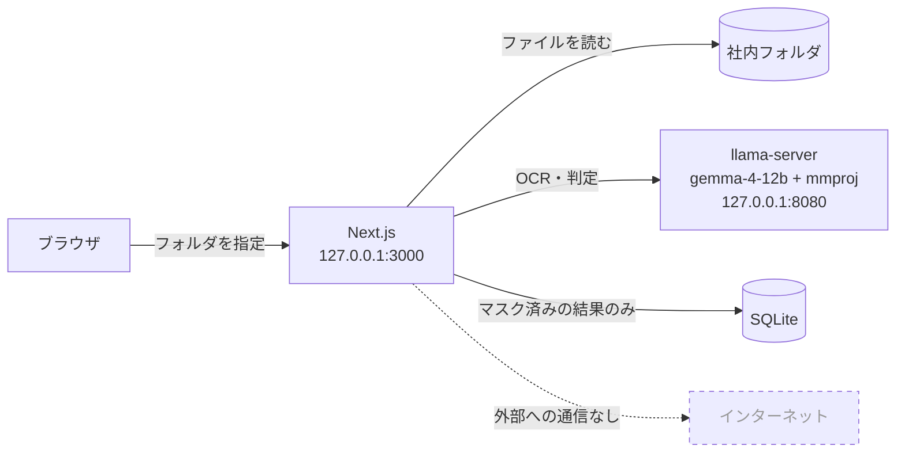
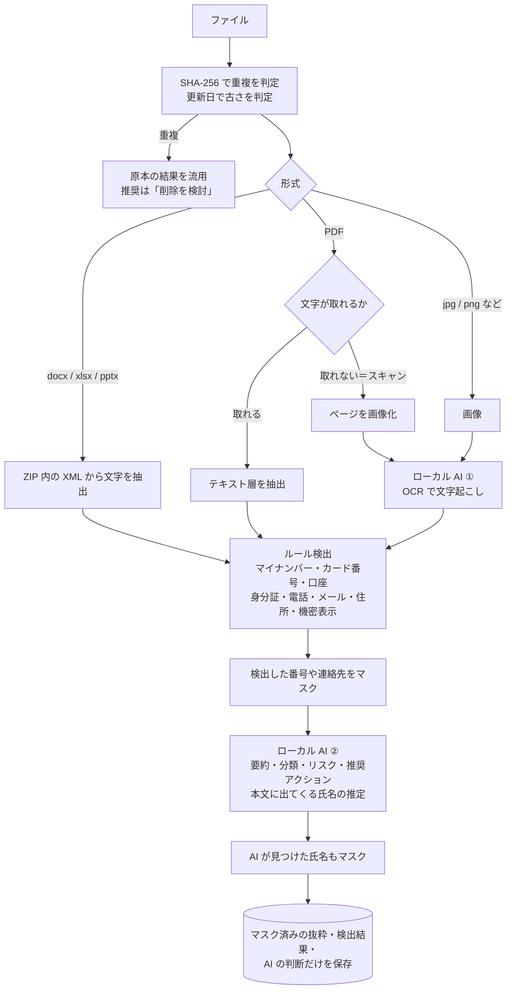

# ファイル棚卸しアシスタント（デモ）

人の手では整理しきれなくなった社内のファイル群を、**ローカルで動く生成 AI** の力を借りて棚卸しする Web アプリのデモです。
フォルダを指定すると、個人情報や機密情報が含まれていそうなファイル、重複や古いファイルを洗い出し、**「次に何をすればいいか」だけを短く示します**。

- Office（Word / Excel / PowerPoint）、PDF、**スキャンした書類や画像**まで読み取ります
- AI は **この PC 上の llama.cpp で動かします**。ファイルの中身を外部に送信しません
- 結果は「やることリスト」で表示し、解説文はなるべく読ませません
- アプリは指摘するだけで、ファイルの移動や削除はしません（操作するのは社員本人です）
- 時間のかかる棚卸しは途中で**中断**し、あとから**再開**できます（終わったファイルはやり直しません。サーバを止めた場合も再開できます）
- 結果には生の個人情報を残しません（番号・連絡先・氏名はマスクして保存します）

> セキュリティ製品ではありません。「自分の PC や共有フォルダに、何がどこにあるか分からない」という状態を、短時間で見える化するための補助ツールです。

## 画面

### 1. フォルダを指定して棚卸しを開始

ローカル LLM への接続状況と、画像の文字読み取りに対応しているかを表示します。


### 2. やることリスト（結果画面の最初のタブ）

分析結果を、**4つの動詞**（移す・消す・整理する・確認する）に分けて並べます。
理由はタグ1つだけで、AI の要約などは「▸」を開いたときにだけ表示します。

- **まずこの3件**：リスクの高い順に、最初に手を付けるべきファイルを示します
- **Finder で表示 / パスをコピー**：ファイルの場所をすぐ開けます（アプリはファイルを動かしません）
- **済 / 対応しない**：押すと「やること◯件」が減り、全部終わると「すべて対応しました」と表示します。状態はこの PC の DB に保存し、「戻す」で取り消せます


| 区分 | 社員への一言 |
|---|---|
| 移す | 個人情報や機密情報があります。共有フォルダやデスクトップに置かないでください |
| 消す | 重複しているか、役目を終えています。不要なら削除してください |
| 整理する | 3年以上使っていません。不要なら削除してください |
| 確認する | 判断がつきませんでした。中身を見てください |

### 3. 詳しい分析（2つ目のタブ）

集計やグラフ、全ファイルの一覧は、関心のある人向けに「詳しい分析」タブにまとめています。


### 4. ファイルの詳細（スキャン画像の例）

スキャンした申込書をローカル LLM で文字に起こし、カード番号・連絡先・住所・氏名を検出しています。
検出箇所も抜粋も、マスクした状態で表示します。


### 5. ファイルの詳細（名簿・重複の例）

マイナンバーを含む社員名簿です。内容が同じファイル（`社員名簿_最終版(1).xlsx`）も合わせて表示します。


> 画面写真は、`npm run testdata` で生成する**架空のデータ**を使っています。

## 仕組み

### 全体像

すべての構成要素が 1 台の PC の中で完結しています。ブラウザ・Web サーバ・LLM サーバは、いずれも `127.0.0.1` だけで待ち受けます。



### 1ファイルの処理の流れ



### ローカル AI の関わり方

このアプリでは、AI に「何でも任せる」のではなく、**ルールで確実に判定できることはルールで、人の読解が必要なところだけを AI で**、と役割を分けています。

| 役割 | 何をするか | 入力 | 出力 |
|---|---|---|---|
| ① 文字起こし（OCR） | スキャン PDF のページや画像に写った文字を読み取る | 画像（長辺 1600px の JPEG） | テキスト |
| ② 判定 | ファイルの要約・分類、個人情報や機密の有無、リスク、推奨アクションを決める | パス・更新日・ルール検出の結果・**マスク済みの本文**（先頭 6,000 字） | JSON（スキーマで形式を固定） |
| ③ 氏名の推定 | 正規表現では拾えない「人の名前」を見つけ、マスクに使う | ②と同じ | 氏名のリスト（**保存せず、マスクにだけ使う**） |

設計上のポイント:

- **ルールで確実なものは AI に頼らない。** マイナンバーはチェックデジット、カード番号は Luhn で検証します。AI の判断が揺れても、これらの検出結果は変わりません。
- **AI にはマスクした本文を渡す。** LLM はローカルですが、AI の出力（要約など）に生の番号が写り込んで保存されるのを防ぐためです。
- **リスクは「ルール」と「AI」の高い方を採る。** 見落としを減らす方向に倒しています。
- **重複は AI を使わずに決める。** 内容が同一（SHA-256 が一致）のファイルは、更新日が最も古いものを原本とし、それ以外は原本の結果を流用して「削除を検討」とします。
- **AI の判断は参考情報です。** 最終的な扱いは担当者が決める前提です。

### 推奨アクションと「やること」の対応

AI の推奨アクションを、社員向けの動詞に置き換えて表示します。

| AI の推奨 | やること | 意味 |
|---|---|---|
| アクセス制限 | 移す | 個人情報や機密を含み、業務上は必要そう |
| 削除を検討 | 消す | 目的を終えていそう（古い・重複・一時的なコピー） |
| アーカイブ | 整理する | 個人情報などは無いが、古い・使われていない |
| 要確認 | 確認する | 判断材料が足りない |
| そのまま | （表示しない） | 問題なし。件数だけ表示 |

「まずこの3件」は、リスク → マイナンバー・カード番号・口座・身分証の件数 → その他の検出件数、の順で決めます。

## 処理速度（実測）

架空データ 21 ファイル（うち OCR 対象 4 件）を、Apple M5（GPU 10 コア）/ メモリ 32GB で処理したときの値です。

| 構成 | 所要時間 | 生成トークン |
|---|---:|---:|
| 初期実装（思考モード ON・出力長の制限なし） | 約 640 秒 | — |
| 思考モード OFF ＋ 出力長の制限、`--parallel 2` | 222〜257 秒 | 2,898 |
| 同上で `--parallel 4` に変更 | 269〜288 秒 | 2,901 |
| **`--parallel 2` ＋ 重複は AI を省略 ＋ 1行 JSON（現在）** | **183〜207 秒** | **1,805** |

わかったこと:

- 所要時間は、ほぼ **「生成トークン数 ÷ 生成速度（約 12 tok/s）」** で決まります。速くするには出力を短くするのが一番効きます。
- このマシンでは、`--parallel` を増やしても全体の生成速度は伸びず、かえって遅くなりました。
- gemma-4 の思考モードを切る（`chat_template_kwargs: { enable_thinking: false }`）と、判定 1 件が約 25 秒から約 2 秒に縮みます。
- OCR は 1 枚あたり約 15〜17 秒かかります（ほとんどが文字起こしの生成時間です）。

## 必要なもの

- Node.js 24 以上
- `llama-server`（llama.cpp 0.9.0 以上。gemma-4 の mmproj を読むには、これ以降のバージョンが必要です）
- テストデータを作る場合は Python 3

```sh
llama-server -m gemma-4-12b-it-Q4_K_M.gguf --mmproj mmproj-F16.gguf \
  --host 127.0.0.1 --port 8080 -c 32768 --parallel 2 --flash-attn on
```

## 起動

```sh
npm install
npm run testdata   # デモ用の架空ファイル群を testdata/sample-files に生成
npm run dev        # http://127.0.0.1:3000
```

## 設定（環境変数）

| 変数 | 既定値 | 説明 |
|---|---|---|
| `LLM_BASE_URL` | `http://127.0.0.1:8080` | llama-server の URL |
| `LLM_CONCURRENCY` | llama-server のスロット数 | LLM への同時リクエスト数。未指定なら `/props` の `total_slots` に合わせる |
| `SCAN_ALLOWED_ROOTS` | ホームディレクトリ | スキャンを許可するフォルダ（`:` 区切りで複数指定） |
| `SCAN_MAX_FILES` | `2000` | 1 回のスキャンで扱う最大ファイル数 |
| `DB_PATH` | `data/filechecker.db` | 結果の保存先 |

## ディレクトリ構成

```
app/                 画面と API（Next.js App Router）
  api/scans/         スキャンの開始・一覧・結果取得・中断・再開、対応状況の更新、ファイラーで表示
  scans/[id]/        結果画面（やること / 詳しい分析）、ファイル詳細
components/          画面部品（action-list.tsx: やることリスト、actions.ts: 区分と優先度）
lib/
  scanner.ts         走査・重複判定・処理の流れ
  extract.ts         Office / PDF / 画像からの文字抽出
  detect.ts          ルール検出とマスク
  llm.ts             ローカル LLM（OCR・判定）
  db.ts              SQLite
proxy.ts             localhost 以外からのアクセスを拒否
scripts/testdata/    架空テストデータの生成スクリプト
```

## 安全上の前提と制限

- サーバは `127.0.0.1` だけで待ち受けます。さらに `proxy.ts` で、localhost 以外の Host と、別オリジンからの POST を拒否します。
- **トンネル（cloudflared など）や LAN への公開はしないでください。** このアプリは、指定されたフォルダの中身を読み取ることができます。
- スキャンできるのは `SCAN_ALLOWED_ROOTS` 配下だけです。シンボリックリンクはたどりません。
- 「Finder で表示」は、サーバ側で `open -R` を実行してファイルの場所を開くだけです。クライアントからはファイル ID だけを受け取り、DB に記録したパスが許可範囲の中にあることを確かめてから開きます（macOS のみ）。
- 氏名の検出は AI の推定に頼っているため、マスク漏れが起こり得ます。
- 旧形式の Office（.doc / .xls / .ppt）は未対応で、メタ情報だけを記録します。
- PDF の OCR は先頭 3 ページまでです。

## ライセンス

[MIT](LICENSE)
