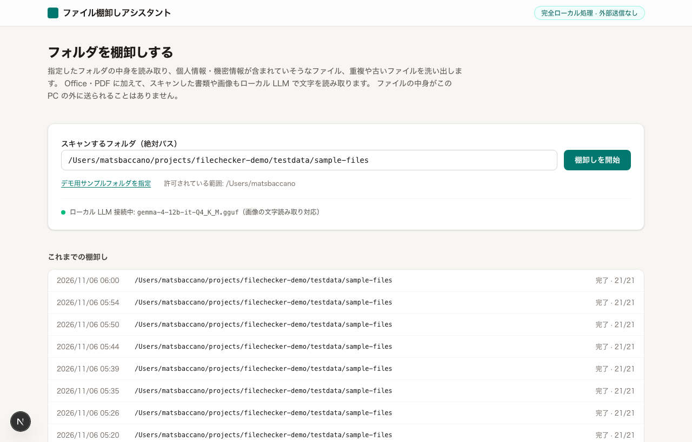
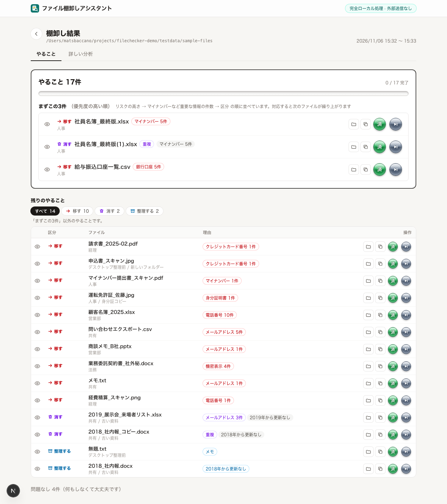
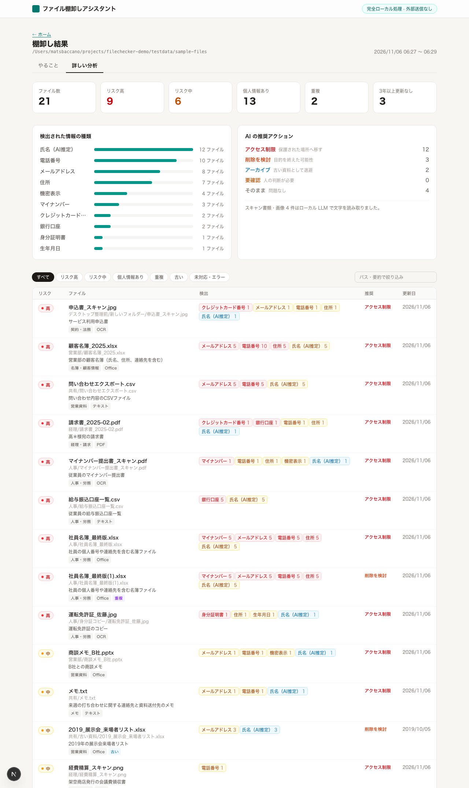
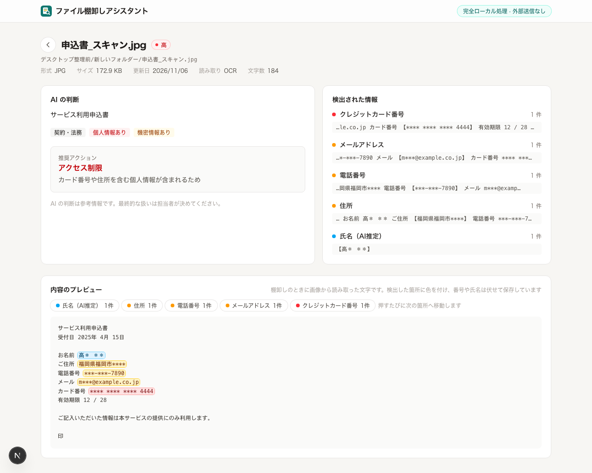
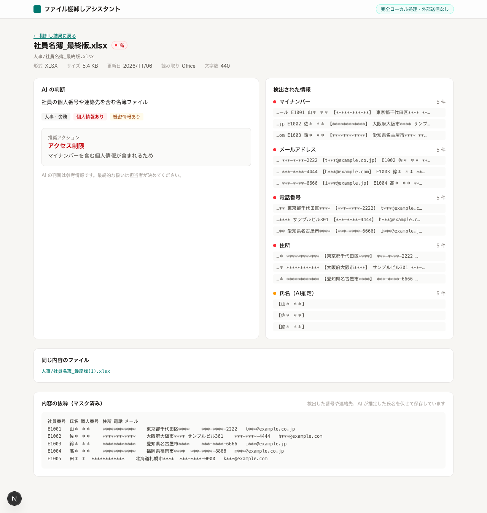
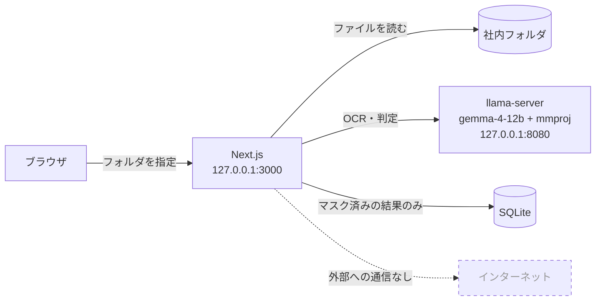
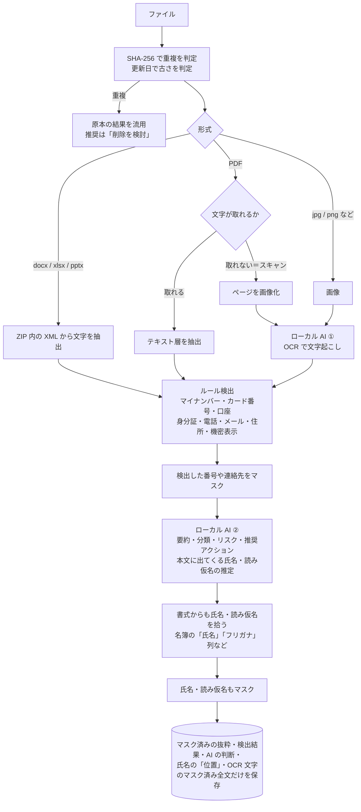

# ファイル棚卸しアシスタント（デモ）

人の手では整理しきれなくなった社内のファイル群を、**ローカルで動く生成 AI** の力を借りて棚卸しする Web アプリのデモです。
フォルダを指定すると、個人情報や機密情報が含まれていそうなファイル、重複や古いファイルを洗い出し、**「次に何をすればいいか」だけを短く示します**。

- Office（Word / Excel / PowerPoint）、PDF、**スキャンした書類や画像**まで読み取ります
- AI は **この PC 上の llama.cpp で動かします**。ファイルの中身を外部に送信しません
- 結果は「やることリスト」で表示し、解説文はなるべく読ませません
- ファイルを開かなくても、**どこに何があるかをプレビューで確認**できます（検出箇所に色を付け、番号・氏名は伏せて表示）
- アプリは指摘するだけで、ファイルの移動や削除はしません（操作するのは社員本人です）
- **大きなフォルダ（10 万件まで）も、時間をかけてすべて棚卸し**します。途中で**中断**し、あとから**再開**できます（終わったファイルはやり直しません。サーバを止めた場合も再開できます）
- 中身を読めなかったファイルも「確認する」として必ず示し、「全部確認できた」と誤解させません
- 結果には生の個人情報を残しません（番号・連絡先・氏名・読み仮名はマスクして保存します）

> セキュリティ製品ではありません。「自分の PC や共有フォルダに、何がどこにあるか分からない」という状態を、短時間で見える化するための補助ツールです。

## 画面

### 1. フォルダを指定して棚卸しを開始

ローカル LLM への接続状況と、画像の文字読み取りに対応しているかを表示します。



### 2. やることリスト（結果画面の最初のタブ）

分析結果を、**4つの動詞**（移す・消す・整理する・確認する）に分けて並べます。
区分は色だけでなくアイコンでも見分けられます（移す＝矢印、消す＝ゴミ箱、整理する＝箱、確認する＝？）。

- **やること◯件・まずこの3件**：進み具合のバーの下に、優先度の高い順に最初に手を付けるべき3件を示します。対応すると次のファイルが繰り上がり、全部終わると「すべて対応しました」と表示します
- **残りのやること**：表にまとめ、「すべて / 移す / 消す / 整理する / 確認する / 対応済み・対応しない」で絞り込めます。ファイルが多いときは 50 件ずつページ送りします
- **理由**：区分を決めた理由のタグに加え、隠れていた理由（重複・長く更新なし・個人情報・中身未確認など）を灰色の補足タグで示します
- **行のアイコン**：左端の目のアイコンでファイル詳細（AI の判断とプレビュー）へ移ります。右側のフォルダのアイコンでファイルの場所を開き（Finder / エクスプローラー）、重なった紙のアイコンでパスをコピーします（アプリはファイルを動かしません）
- **済 / 対応しない**：押すと「やること◯件」が減ります。状態はこの PC の DB に保存し、「元に戻す」や「対応済み・対応しない」の絞り込みの「戻す」で取り消せます
- 棚卸しの最中は、進み具合・**残り時間の目安**・スリープしない設定にする案内を表示し、見つかったものから順にやることへ追加します



| 区分 | 社員への一言 |
|---|---|
| 移す | 個人情報や機密情報があります。共有フォルダやデスクトップに置かないでください |
| 消す | 重複しているか、役目を終えています。不要なら削除してください |
| 整理する | 3年以上使っていません。不要なら削除してください |
| 確認する | 判断がつきませんでした。中身を見てください |

形式が未対応・大きすぎる・読み込みに失敗したなどで**中身を確認できなかったファイル**は、AI の推奨に関係なく常に「確認する」に回し、「中身未確認」「読み込みエラー」のタグと件数を表示します。

### 3. 詳しい分析（2つ目のタブ）

集計やグラフ、全ファイルの一覧は、関心のある人向けに「詳しい分析」タブにまとめています。一覧はリスク・個人情報・重複などで絞り込み、パスや要約で検索でき、50 件ずつページ送りします。



### 4. ファイルの詳細（スキャン画像の例）

スキャンした申込書をローカル LLM で文字に起こし、カード番号・連絡先・住所・氏名を検出しています。
画面下の「内容のプレビュー」では、読み取った文字の上で検出箇所に色を付け（危険度 高＝赤 / 中＝黄 / 低＝青）、「マイナンバー 5件」などのボタンを押すたびに次の箇所へ移動できます。
番号・氏名・読み仮名は伏せて表示します（例：`山＊ ＊＊`、`ヤ＊＊ ＊＊＊`）。やることリストの目のアイコンから来たときは、プレビューまで自動でスクロールします。



### 5. ファイルの詳細（名簿・重複の例）

マイナンバーを含む社員名簿です。内容が同じファイル（`社員名簿_最終版(1).xlsx`）も合わせて表示します。
文字のあるファイル（テキスト・Office・文字のある PDF）のプレビューは、**開くたびにファイルを読み直して作り、保存しません**。



> 画面写真は、`npm run testdata` で生成する**架空のデータ**を使っています。

## 仕組み

### 全体像

すべての構成要素が 1 台の PC の中で完結しています。ブラウザ・Web サーバ・LLM サーバは、いずれも `127.0.0.1` だけで待ち受けます。



### 1ファイルの処理の流れ



### ローカル AI の関わり方

このアプリでは、AI に「何でも任せる」のではなく、**ルールで確実に判定できることはルールで、人の読解が必要なところだけを AI で**、と役割を分けています。

| 役割 | 何をするか | 入力 | 出力 |
|---|---|---|---|
| ① 文字起こし（OCR） | スキャン PDF のページや画像に写った文字を読み取る | 画像（長辺 1600px の JPEG） | テキスト |
| ② 判定 | ファイルの要約・分類、個人情報や機密の有無、リスク、推奨アクションを決める | パス・更新日・ルール検出の結果・**マスク済みの本文**（先頭 6,000 字） | JSON（スキーマで形式を固定） |
| ③ 氏名の推定 | 正規表現では拾えない「人の名前」とその読み仮名を見つけ、マスクに使う | ②と同じ | 氏名・読み仮名のリスト（**保存せず、マスクにだけ使う**） |

設計上のポイント:

- **ルールで確実なものは AI に頼らない。** マイナンバーはチェックデジット、カード番号は Luhn で検証します。AI の判断が揺れても、これらの検出結果は変わりません。
- **AI にはマスクした本文を渡す。** LLM はローカルですが、AI の出力（要約など）に生の番号が写り込んで保存されるのを防ぐためです。
- **リスクは「ルール」と「AI」の高い方を採る。** 見落としを減らす方向に倒しています。
- **重複は AI を使わずに決める。** 内容が同一（SHA-256 が一致）のファイルは、更新日が最も古いものを原本とし、それ以外は原本の結果を流用して「削除を検討」とします。
- **氏名は AI と書式の両方で拾う。** AI が返す氏名は 20 件までなので、名簿の「氏名」「社員名」「姓」「名」「フリガナ」などの列や、「氏名 山田 太郎」の書き方からも拾い、大きな名簿でも全員を伏せます。伏せる処理は全員分を 1 回の走査でまとめて行うので、人数が多くても遅くなりません。
- **氏名そのものは保存しない。** プレビューで同じ箇所を伏せ直せるよう、本文の中で氏名が出てくる「位置」だけを保存します。棚卸しのあとにファイルの内容が変わり、確実に伏せられない場合は、プレビューの代わりに保存済みの抜粋を表示します。
- **AI の判断は参考情報です。** 最終的な扱いは担当者が決める前提です。

### 推奨アクションと「やること」の対応

AI の推奨アクションを、社員向けの動詞に置き換えて表示します。

| AI の推奨 | やること | 意味 |
|---|---|---|
| アクセス制限 | 移す | 個人情報や機密を含み、業務上は必要そう |
| 削除を検討 | 消す | 目的を終えていそう（古い・重複・一時的なコピー） |
| アーカイブ | 整理する | 個人情報などは無いが、古い・使われていない |
| 要確認 | 確認する | 判断材料が足りない（中身を読めなかったファイルも常にここ） |
| そのまま | （表示しない） | 問題なし。件数だけ表示 |

「まずこの3件」は、リスク → マイナンバー・カード番号・口座・身分証の件数 → その他の検出件数、の順で決めます。

## 大きなフォルダの棚卸し

ファイルが多くても、時間をかけてすべて棚卸しできるようにしています（既定の上限は 10 万件）。

- ファイルは見つけたそばから DB に入れ、全件をメモリに持ちません。重複の判定も DB でまとめて行います
- 結果画面は、棚卸しの最中は進み具合だけを 2 秒ごとに取得し、表は 50 件ずつサーバから受け取ります（10 万件でも 1 回の取得は 1 秒以内）
- 所要時間は 1 件あたり数秒です（1 万件で半日ほど、10 万件で 5 日ほど）。画面に残り時間の目安を表示します
- **PC がスリープすると処理が止まります。** 終わるまでスリープしない設定にしてください。止まっても「再開」で続きから進められます
- 上限を超えた分は棚卸しせず、結果画面とホームの履歴に「上限で打ち切り」と表示します

## AI の性能分析

ヘッダー右上の「AI の分析」（`/ai`）で、棚卸しで使った AI の記録を集計して見られます。**ファイルの本文・氏名・AI の入出力そのものは記録せず、数字と種類だけ**をためます（棚卸しの記録を消しても残ります）。

- **速さと失敗**：読み取り（OCR）と判定それぞれの回数・失敗の割合（時間切れ・JSON の形の誤りなど）・1回の時間・生成の速さ。モデルと指示文の版（指示文を書き換えると自動で変わる）ごとに比べられます
- **判断の比較**：ルールと AI のリスクの対応表（AI がルールより低く判定した件数＝見落としの疑い）、書式のルールで拾えた氏名・読み仮名を AI も見つけられた割合
- **担当者の判断**：やることリストの「済」「対応しない」を区分・指示文の版ごとに集計し、「対応しない」の割合（見当違いの指摘の多さ）を示します
- **テストデータでの評価**：テストデータ（すべて架空）の正解と比べた結果の履歴です

### テストデータでの評価（`npm run eval`）

```sh
npm run testdata                # テストデータと正解を作る
npm run eval                    # 各ファイルをアプリと同じ処理に通し、正解と比べる（数分かかる。llama-server が必要）
npm run eval -- --set hard      # 難しいテストデータだけを評価する（sample で標準だけ）
```

テストデータは2種類です。

| データ | フォルダ / 正解 | 内容 |
|---|---|---|
| 標準 | `testdata/sample-files` / `testdata/expected.json` | デモ用のサンプル（21 ファイル） |
| 難しい | `testdata/hard-files` / `testdata/expected-hard.json` | 強く劣化したスキャン、写真に撮った名刺、表記ゆれの名簿（半角カナ・全角数字）、25 人の氏名がある議事録、メールの署名、英語の履歴書、2 ページ目に個人番号があるスキャン PDF、チェックデジットが合わない紛らわしい番号（8 ファイル） |

氏名・読み仮名の再現率と適合率、リスク・推奨の一致率、伏せたあとに残った氏名（伏せ漏れ）、画像の読み取り、ルール検出の正確さを測り、結果を「AI の分析」画面に並べます。モデルや指示文を変えたら評価し直すと、同じ物差しで比べられます。正解（受け入れてよいリスクや推奨）は `scripts/testdata/generate.py` の `expected()` と `expected_hard()` で定めています。照合では、空白と半角・全角の違いを無視します。

## 処理速度（実測）

架空データ 21 ファイル（うち OCR 対象 4 件）を、Apple M5（GPU 10 コア）/ メモリ 32GB で処理したときの値です。

| 構成 | 所要時間 | 生成トークン |
|---|---:|---:|
| 初期実装（思考モード ON・出力長の制限なし） | 約 640 秒 | — |
| 思考モード OFF ＋ 出力長の制限、`--parallel 2` | 222〜257 秒 | 2,898 |
| 同上で `--parallel 4` に変更 | 269〜288 秒 | 2,901 |
| **`--parallel 2` ＋ 重複は AI を省略 ＋ 1行 JSON（現在）** | **183〜207 秒** | **1,805** |

わかったこと:

- 所要時間は、ほぼ **「生成トークン数 ÷ 生成速度（約 12 tok/s）」** で決まります。速くするには出力を短くするのが一番効きます。
- このマシンでは、`--parallel` を増やしても全体の生成速度は伸びず、かえって遅くなりました。
- gemma-4 の思考モードを切る（`chat_template_kwargs: { enable_thinking: false }`）と、判定 1 件が約 25 秒から約 2 秒に縮みます。
- OCR は 1 枚あたり約 15〜17 秒かかります（ほとんどが文字起こしの生成時間です）。

## 必要なもの

- Node.js 24 以上
- `llama-server`（llama.cpp 0.9.0 以上。gemma-4 の mmproj を読むには、これ以降のバージョンが必要です）
- テストデータを作る場合は Python 3

```sh
llama-server -m gemma-4-12b-it-Q4_K_M.gguf --mmproj mmproj-F16.gguf \
  --host 127.0.0.1 --port 8080 -c 32768 --parallel 2 --flash-attn on
```

## 起動

```sh
npm install
npm run testdata   # デモ用の架空ファイル群を testdata/sample-files に生成
npm run dev        # http://127.0.0.1:3000
```

## 設定（環境変数）

| 変数 | 既定値 | 説明 |
|---|---|---|
| `LLM_BASE_URL` | `http://127.0.0.1:8080` | llama-server の URL |
| `LLM_CONCURRENCY` | llama-server のスロット数 | LLM への同時リクエスト数。未指定なら `/props` の `total_slots` に合わせる |
| `SCAN_ALLOWED_ROOTS` | ホームディレクトリ | スキャンを許可するフォルダ（`:` 区切りで複数指定） |
| `SCAN_MAX_FILES` | `100000` | 1 回のスキャンで扱う最大ファイル数。極端に大きなフォルダのときだけ働く安全のための上限で、超えた分は棚卸しせず画面に「上限で打ち切り」と表示する。ファイルが多いと時間がかかる（1 件あたり数秒。1 万件で半日ほど）ので、PC がスリープしない設定にしておく。途中で止まっても「再開」で続きから進められる |
| `DB_PATH` | `data/filechecker.db` | 結果の保存先 |

## ディレクトリ構成

```
app/                 画面と API（Next.js App Router）
  api/scans/         スキャンの開始・一覧・進み具合・中断・再開、やること / 詳しい分析の集計（ページ分け）、
                     対応状況の更新、ファイラーで表示、内容のプレビュー
  scans/[id]/        結果画面（やること / 詳しい分析）、ファイル詳細
  icon.svg           ブラウザのタブのアイコン（ロゴ「書類とルーペ」）
components/          画面部品（action-list.tsx: やることリスト、actions.ts: 区分と優先度、
                     scan-dashboard.tsx: 詳しい分析、text-preview.tsx: 内容のプレビュー、logo.tsx: ロゴ）
lib/
  scanner.ts         走査・重複判定・処理の流れ・プレビューの作成
  views.ts           結果画面の集計（やること / 詳しい分析、50 件ずつのページ分け）
  metrics.ts         AI の性能分析の記録と集計（数字だけを記録）
  eval.ts            テストデータの正解を使った評価（npm run eval）
  extract.ts         Office / PDF / 画像からの文字抽出
  detect.ts          ルール検出とマスク（氏名・読み仮名の書式ルールを含む）
  llm.ts             ローカル LLM（OCR・判定）
  db.ts              SQLite
proxy.ts             localhost 以外からのアクセスを拒否
scripts/testdata/    架空テストデータと評価の正解の生成スクリプト
scripts/eval/        評価の実行スクリプト（npm run eval）
```

## 安全上の前提と制限

- サーバは `127.0.0.1` だけで待ち受けます。さらに `proxy.ts` で、localhost 以外の Host と、別オリジンからの POST を拒否します。
- **トンネル（cloudflared など）や LAN への公開はしないでください。** このアプリは、指定されたフォルダの中身を読み取ることができます。
- スキャンできるのは `SCAN_ALLOWED_ROOTS` 配下だけです。シンボリックリンクはたどりません。
- 「Finder で表示」（Windows では「エクスプローラーで表示」、Linux では「フォルダを開く」）は、サーバ側でファイラーを起動してファイルの場所を開くだけです。クライアントからはファイル ID だけを受け取り、DB に記録したパスが許可範囲の中にあることを確かめてから開きます。
- プレビューのためにファイルを読み直すときも、パスはクライアントから受け取らず、許可範囲の確認とファイルの同一性の確認を通してから読みます。
- 氏名の検出は AI の推定と書式のルールに頼っているため、名簿の形でない長い文章（多人数の議事録など）では、マスク漏れが起こり得ます。
- 姓と名が別の列の名簿で、名が 1 文字（「健」など）の場合は、その名を伏せません（1 文字で伏せると関係ない語まで伏せてしまうため）。
- 旧形式の Office（.doc / .xls / .ppt）は未対応で、メタ情報だけを記録します（やることリストでは「中身未確認」として「確認する」に入ります）。
- PDF の OCR は先頭 3 ページまでです。

## ライセンス

[MIT](LICENSE)
